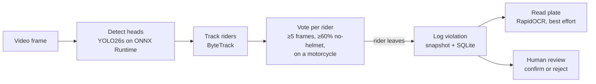
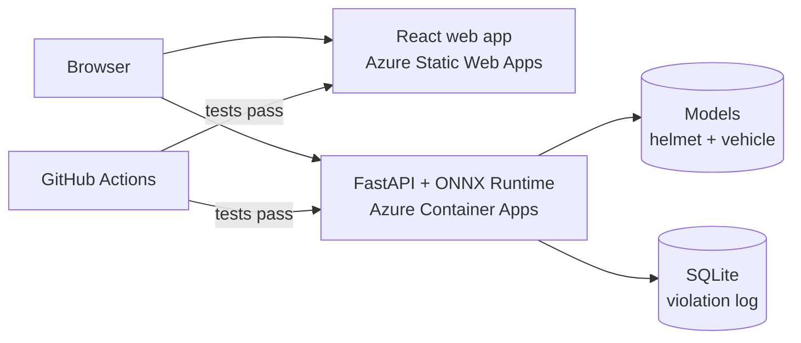

# RideSafe AI: Helmet Violation Detection

**Finds two-wheeler riders without a helmet in traffic video, decides once per rider, and queues each violation for a
person to confirm.** YOLO26 + ByteTrack + plate OCR, served by a torch-free FastAPI service and a React review app,
deployed on Azure.

[](https://github.com/Md-Faiz-Alam/helmet-violation-detection/actions/workflows/ci.yml)
[](https://ashy-wave-07c0e0600.8.azurestaticapps.net)
[](LICENSE)


<p align="center">
  <a href="https://ashy-wave-07c0e0600.8.azurestaticapps.net">
    
  </a>
  <br>
  <sub>The live demo's sample: every rider tracked and decided once. Faces and plates blurred. Video: Aamir Somewhere, Pexels.</sub>
</p>

**[▶ Try the live demo](https://ashy-wave-07c0e0600.8.azurestaticapps.net)**: analyse your own photo or short video,
or explore the sample. Uploads are deleted after an hour. The API sleeps when idle, so the first request can take
about 30 s.

---

## Highlights

- **Measured per rider, on real video.** A hand-labelled benchmark of 4 traffic clips (54 riders, 40 violators)
  scores each rider, not each frame, because that is what a fine is issued for.
- **A failure found and fixed with data.** The video benchmark showed caps and skullcaps being read as helmets.
  2,537 extra training images, leak-checked against the test data, raised held-out headwear mAP50 from **0.32 to 0.81**.
- **No PyTorch in production.** ONNX Runtime and a numpy port of ByteTrack make the same decisions as the PyTorch
  pipeline about **2× faster on CPU**, in a **620 MB** image instead of 2.27 GB.
- **A person makes the call.** Every violation waits in a review console with its snapshot, frame votes and plate;
  nothing is enforced automatically.
- **Shipped like a product.** Access control, rate limits, signed links and an audit trail; 84 Python and 6 web tests;
  every push to `main` redeploys to Azure, but only after all tests pass.

## Results

| Evaluation (never used for training or tuning) | Result |
|---|---|
| Original test set (63 images) | mAP50 **0.937**, no-helmet recall 0.85 |
| Headwear test set (635 images: caps, turbans, hijabs, masks, rear views) | mAP50 **0.81** (was 0.32) |
| Video, per rider (4 test clips, 40 violators) | **18 of 40** violators caught, **75%** of logs correct, **0** helmeted riders flagged |
| CPU speed (Intel i7-7700K) | ~16 FPS tracking video, 97 ms per 640 px image |

The model is YOLO26s, chosen on validation data from 9 trained experiments. Video recall is the weak spot: it ranges
from 67% on clean highway traffic to 35% at a crowded junction, mostly far-away riders and headwear still read as a
helmet. Full evaluation, with the experiments, the threshold choice and the error analysis:
**[docs/EVALUATION.md](docs/EVALUATION.md)**.

## How it works



1. **Detect:** the model finds every head and classifies it as helmet or no helmet; tuned thresholds favour catching
   violators.
2. **Track:** ByteTrack follows each head across frames, so one rider is one track, not hundreds of detections.
3. **Decide once:** each frame is a vote; a rider is a violator with at least 5 no-helmet votes making up at least
   60% of their votes, decided when they leave the frame, and only if their head sits on a motorcycle (a second
   model checks, so pedestrians and cyclists are not logged). Split votes are marked *uncertain* for a reviewer.
4. **Log and review:** the violation is saved the moment it is decided, with a snapshot and (when readable) the
   plate, and waits for a person to confirm or reject it.

## Architecture



| Layer | Technology |
|---|---|
| Model and training | Ultralytics YOLO26s, PyTorch (training only), Kaggle GPU, MLflow |
| Inference | ONNX Runtime, numpy ByteTrack, OpenCV, RapidOCR |
| API | FastAPI, async video jobs, SQLite |
| Web app | React 19, TypeScript, Vite, Tailwind CSS, TanStack Query, Recharts |
| Delivery | Docker, GitHub Actions, GitHub Container Registry, Azure Container Apps + Static Web Apps, OIDC |

## Quick start

**Run everything locally with Docker** (no Python or Node needed):
```bash
git clone https://github.com/Md-Faiz-Alam/helmet-violation-detection.git
cd helmet-violation-detection
docker compose up --build        # web app: http://localhost:8080   API docs: http://localhost:8000/docs
```

**Or set up for development:**
```bash
python -m venv .venv
.venv\Scripts\activate                               # Mac/Linux: source .venv/bin/activate
pip install -r requirements-dev.txt
python scripts/export_onnx.py --vehicles             # once: export the models to ONNX
uvicorn ridesafe.api:app --port 8000                 # API
cd frontend && npm install && npm run dev            # web app on http://localhost:5173
```

**Track riders in your own video from the command line:**
```bash
python scripts/track_video.py --source path/to/video.mp4 --show
```

## Using it

- **Web app:** *Overview* (results and the sample), *Analyze* (photo, or video with tracked boxes in sync with
  playback and a timeline of riders), *Review* (confirm or reject each violation; keys J/K, C, R, U) and *Model card*.
- **HTTP API:** `POST /detect` for images, `POST /jobs/video` for videos, `GET/PATCH /violations` for the review
  queue. Endpoints, access rules and settings: **[docs/API.md](docs/API.md)**.
- **Command line:** image and video tools, webcam and RTSP streams, the violation log, training and evaluation:
  **[docs/DEVELOPMENT.md](docs/DEVELOPMENT.md)**.

## Documentation

| Guide | What is in it |
|---|---|
| [docs/EVALUATION.md](docs/EVALUATION.md) | model selection, headwear data, thresholds, findings, video benchmark, plate accuracy |
| [docs/DEVELOPMENT.md](docs/DEVELOPMENT.md) | setup, project structure, dataset, command-line tools, training, tests |
| [docs/API.md](docs/API.md) | endpoints, author and visitor access, security, settings |
| [docs/DEPLOYMENT.md](docs/DEPLOYMENT.md) | Docker, Azure architecture, continuous deployment, cost, the anonymised sample |
| [docs/ROADMAP.md](docs/ROADMAP.md) | what has been built and what comes next |
| [reports/](reports/README.md) | generated evaluation reports |

## Project structure

```
backend/ridesafe/   torch-free runtime and API: detector, tracking, plates, video jobs, privacy
frontend/           React web app
scripts/            ML tooling: training, evaluation, data mining, video runs
configs/            training recipe, experiments, thresholds, tracker settings
eval/video_gt/      hand-labelled video ground truth
reports/            generated evaluation reports
models/best.pt      trained YOLO26s weights
deploy/             one-time Azure setup script
docs/               guides
```
The full tree is in [docs/DEVELOPMENT.md](docs/DEVELOPMENT.md#project-structure).

## Limitations and responsible use

- **Recall:** 18 of 40 violators caught on the test clips. Far-away riders and some headwear (headscarves, face
  scarves, woolly caps) are missed.
- **Non-riders:** pedestrians standing among riders can be logged; all 6 false logs on the test clips are of this kind.
- **Small evaluation sets:** 63 test images and 40 video violators, so differences of a few points are noise.
- **Plates are evidence, not proof:** of 3 readable plates on the highway clip, 1 was read correctly at 1080p and
  none at 720p.
- **Personal data:** faces and number plates are personal data. The tool is built to support a human reviewer, not
  to issue automatic fines. Keep outputs private and blur faces and plates before publishing anything.

## Acknowledgements

- [Ultralytics](https://github.com/ultralytics/ultralytics) (YOLOv8, YOLO11, YOLO26) and
  [ByteTrack](https://github.com/ifzhang/ByteTrack), ported to numpy from the Ultralytics implementation
- [Bike Helmet Detection](https://universe.roboflow.com/bike-helmets/bike-helmet-detection-2vdjo/dataset/2) by Syed
  Salman Reza (Public Domain) and [Helmet, Rider, ANPR Detection v12](https://universe.roboflow.com/onlytusik/helmet-rider-anpr-detection/dataset/12)
  by OnlyTusik (CC BY 4.0), on Roboflow Universe
- Test videos from [Pexels](https://www.pexels.com/) (Pexels license; downloaded by URL, listed in
  [`eval/video_gt/videos.yaml`](eval/video_gt/videos.yaml)). The public sample is a blurred copy of
  [a clip by Aamir Somewhere](https://www.pexels.com/video/34395449/).
- [RapidOCR](https://github.com/RapidAI/RapidOCR) (PaddleOCR models on ONNX Runtime)

## License

[AGPL-3.0](LICENSE). The project builds on Ultralytics, which is AGPL-3.0, so this code, and any service that runs it
for other people (such as the live demo), is shared under the same license. The datasets and videos keep their own
licenses.
