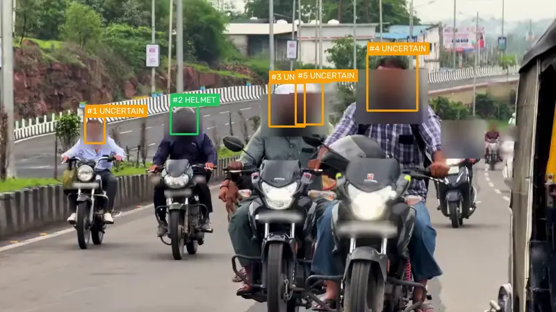
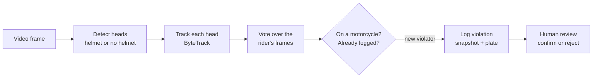
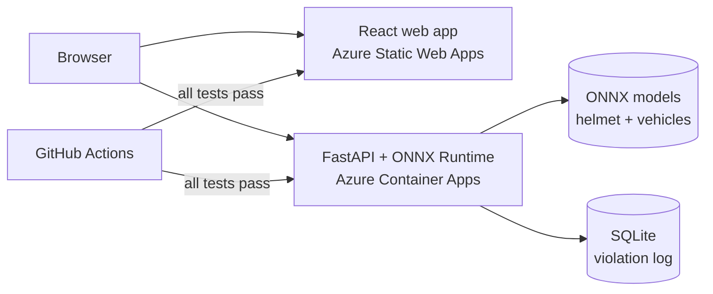

# RideSafe AI: Helmet Violation Detection

**Finds two-wheeler riders without a helmet in traffic video, makes one decision per rider, and sends each violation
to a person for review.** Built with YOLO26, ByteTrack and ONNX Runtime; served by a FastAPI service and a React web
app; deployed on Azure.

[](https://github.com/Md-Faiz-Alam/helmet-violation-detection/actions/workflows/ci.yml)
[](https://ashy-wave-07c0e0600.8.azurestaticapps.net)
[](LICENSE)


<p align="center">
  <a href="https://ashy-wave-07c0e0600.8.azurestaticapps.net">
    
  </a>
  <br>
  <sub>The live demo's sample: every rider is tracked and decided once. Faces and plates blurred. Video: Aamir Somewhere, Pexels.</sub>
</p>

**[▶ Try the live demo](https://ashy-wave-07c0e0600.8.azurestaticapps.net)**: check your own photo or short video,
or explore the sample. Uploads are deleted after an hour. The server sleeps when idle, so the first request can take
about 30 seconds.

**Contents:** [Why it exists](#why-it-exists) · [Results](#results) · [How it works](#how-it-works) ·
[Getting started](#getting-started) · [Usage](#usage) · [Project structure](#project-structure) ·
[Documentation](#documentation) · [Limitations](#limitations-and-responsible-use) · [License](#license)

---

## Why it exists

Helmet laws are checked by people looking at traffic, and most detection demos stop at boxes on single frames. A
real system has to answer a different question: **which riders, in this video, broke the rule?** One rider appears
in hundreds of frames, pedestrians and cyclists are not riders of a motorcycle, and every fine needs evidence that a
person has checked.

RideSafe AI is built around that question:

- **One decision per rider.** Each head is tracked through the video and judged on all its frames, so one blurry frame
  does not create a violation and one rider is not logged a hundred times.
- **Measured the way it is used.** A hand-labelled video benchmark scores each rider, not each frame or box.
- **A person makes the call.** Every violation waits in a review console with its snapshot, frame votes and number
  plate; nothing is enforced automatically.
- **Runs on a CPU.** The models run on ONNX Runtime without PyTorch, about 2× faster, in a 620 MB container.

## Results

| Evaluation (data never used for training or tuning) | Result |
|---|---|
| **Video, per rider** (4 hand-labelled test clips: 54 riders, 40 violators) | **17 of 18** logged violations correct (94%), **17 of 40** violators caught (42%), **no** helmeted rider ever flagged |
| Photos: original test set (63 images) | mAP50 **0.937**; 85% of heads without a helmet found |
| Photos: headwear test set (635 images of caps, turbans, hijabs, masks, rear views) | mAP50 **0.81**, up from 0.32 before the extra training data |
| Speed on a CPU (Intel i7-7700K) | 6-12 analysed video frames per second with every check and plate reading on; under 0.1 s per photo |

**What this means:** when the system logs a violation it is almost always right, but it misses more than half of the
violators, mostly riders far from the camera and headwear it still mistakes for a helmet (headscarves, woolly caps).
It is tuned this way on purpose: a wrong fine is worse than a missed one. With 40 violators the recall estimate is
uncertain (29-58% at 95% confidence).

The model is YOLO26s, chosen on validation data from 9 trained experiments. The full evaluation, including
everything that was tried and rejected, is in **[docs/EVALUATION.md](docs/EVALUATION.md)**.

## How it works



1. **Detect.** A YOLO26s model finds every head and classifies it as *helmet* or *no helmet*. The confidence
   thresholds were tuned to favour catching violators.
2. **Track.** ByteTrack follows each head from frame to frame, so a rider becomes one track instead of hundreds of
   separate detections.
3. **Vote.** Every frame is a vote. A rider is a violator when at least 5 frames, and at least 60% of their frames,
   say *no helmet*. The decision is made when the rider leaves the picture; split votes are marked *uncertain* for a
   reviewer.
4. **Check.** A second, general-purpose model confirms the head sits on a **motorcycle**, so pedestrians and cyclists
   are not logged. A rider who was hidden for a moment and reappears at the same place is **linked to their first
   log** instead of being logged twice.
5. **Log and review.** The violation is saved immediately with a snapshot and, when readable, the number plate, and
   waits in the review queue for a person to confirm or reject it.

### Architecture



| Layer | Technology |
|---|---|
| Model training | Ultralytics YOLO26s, PyTorch (training only), Kaggle GPU |
| Inference | ONNX Runtime, ByteTrack (ported to numpy), OpenCV, RapidOCR for plates |
| API | FastAPI, background video jobs, SQLite |
| Web app | React 19, TypeScript, Vite, Tailwind CSS, TanStack Query, Recharts |
| Delivery | Docker, GitHub Actions, GitHub Container Registry, Azure Container Apps and Static Web Apps |

## Getting started

### Option 1: Docker (the quickest way)

Needs only [Docker](https://docs.docker.com/get-docker/).

```bash
git clone https://github.com/Md-Faiz-Alam/helmet-violation-detection.git
cd helmet-violation-detection
docker compose up --build
```
Open the web app at **http://localhost:8080** and the API documentation at **http://localhost:8000/docs**. The first
build takes a few minutes, because it converts the model to ONNX.

### Option 2: local development

Needs Python 3.13 (3.11+ should work) and, for the web app, Node.js 24.

```bash
git clone https://github.com/Md-Faiz-Alam/helmet-violation-detection.git
cd helmet-violation-detection
python -m venv .venv
.venv\Scripts\activate                       # Mac/Linux: source .venv/bin/activate
pip install -r requirements-dev.txt
python scripts/export_onnx.py --vehicles     # once: converts the models to ONNX

uvicorn ridesafe.api:app --port 8000         # API on http://localhost:8000/docs
cd frontend && npm install && npm run dev    # web app on http://localhost:5173 (in a second terminal)
```

## Usage

**Web app.** *Overview* shows the results and the sample video; *Analyze* checks a photo, or a video with the tracked
boxes drawn in sync with playback; *Review* lists every violation to confirm or reject (keyboard: J/K to move, C, R,
U); *Model card* explains the model, its data and its limits.

**HTTP API.**
```bash
curl -F "file=@samples/image1.jpg;type=image/jpeg" http://localhost:8000/detect
```
returns each head's box, class and confidence. Videos are uploaded to `POST /jobs/video` and analysed in the
background. The full walkthrough, endpoints and access rules: **[docs/API.md](docs/API.md)**.

**Command line.** Track riders in a video file, a webcam or an IP camera, with the same pipeline and settings as the
API:
```bash
python scripts/track_video.py --source path/to/video.mp4 --show
```
It writes an annotated video, a snapshot per violator and a SQLite violation log. More tools (photos, training,
evaluation): **[docs/DEVELOPMENT.md](docs/DEVELOPMENT.md)**.

## Project structure

```
backend/ridesafe/   the runtime and API (no PyTorch): detector, tracking, riding and duplicate checks, plates, jobs
frontend/           React web app
scripts/            training, evaluation, data preparation and video tools
configs/            training recipes, experiments, thresholds, tracker settings
eval/video_gt/      hand-labelled video ground truth and the list of benchmark clips
reports/            generated evaluation reports (every number in this README comes from one)
models/best.pt      the trained YOLO26s weights
samples/            demo photos and the blurred public sample video
deploy/             one-time Azure setup script
docs/               guides
```
The full tree is in [docs/DEVELOPMENT.md](docs/DEVELOPMENT.md#project-structure).

## Documentation

| Guide | Read it to |
|---|---|
| [EVALUATION.md](docs/EVALUATION.md) | understand the results: data, model choice, the video benchmark, what was tried and rejected |
| [DEVELOPMENT.md](docs/DEVELOPMENT.md) | set up, use the command-line tools, train and evaluate models, run the tests |
| [API.md](docs/API.md) | call the API: examples, endpoints, access rules, settings |
| [DEPLOYMENT.md](docs/DEPLOYMENT.md) | run it in Docker or deploy it to Azure; how releases and security work |
| [ROADMAP.md](docs/ROADMAP.md) | see what has been built and what comes next |
| [reports/](reports/README.md) | find the generated report behind any number |

## Testing

Every push runs linting, type checks, 88 unit tests, 8 end-to-end tests with the real models, the web app's tests and
build, and browser tests (Playwright) against the freshly built Docker container. Code reaches the live site only if
all of them pass. How to run them locally: [docs/DEVELOPMENT.md](docs/DEVELOPMENT.md#tests-and-lint).

## Limitations and responsible use

- **Missed violators.** 17 of 40 are caught on the test clips. Far-away riders and some headwear (headscarves, face
  scarves, woolly caps) are missed.
- **People standing in traffic.** A pedestrian standing among moving motorcycles can still be logged (the one false
  log on the test clips).
- **Small evaluation sets.** 63 test photos and 40 video violators, so differences of a few points are noise.
- **Plates are evidence, not proof.** Plate reading is best effort and only some plates are readable at all; a
  person must check every plate.
- **Personal data.** Faces and number plates are personal data. The tool supports a human reviewer and does not issue
  fines. Keep outputs private, and blur faces and plates before publishing anything (the public sample is blurred
  automatically).
- **Turbans** are labelled *no helmet*, which is visually true, but Indian law exempts turban-wearing Sikhs: a
  deployment needs a policy for this, not a blanket rule.

## Acknowledgements

- [Ultralytics](https://github.com/ultralytics/ultralytics) (YOLOv8, YOLO11, YOLO26) and
  [ByteTrack](https://github.com/ifzhang/ByteTrack), ported to numpy from the Ultralytics implementation
- [Bike Helmet Detection](https://universe.roboflow.com/bike-helmets/bike-helmet-detection-2vdjo/dataset/2) by Syed
  Salman Reza (Public Domain) and [Helmet, Rider, ANPR Detection v12](https://universe.roboflow.com/onlytusik/helmet-rider-anpr-detection/dataset/12)
  by OnlyTusik (CC BY 4.0), on Roboflow Universe
- Benchmark videos from [Pexels](https://www.pexels.com/) (Pexels license), listed in
  [`eval/video_gt/videos.yaml`](eval/video_gt/videos.yaml); the public sample is a blurred copy of
  [a clip by Aamir Somewhere](https://www.pexels.com/video/34395449/)
- [RapidOCR](https://github.com/RapidAI/RapidOCR) (PaddleOCR models on ONNX Runtime)

## License

[AGPL-3.0](LICENSE). The project builds on Ultralytics, which is AGPL-3.0, so this code, and any service that runs it
for other people (such as the live demo), is shared under the same license. The datasets and videos keep their own
licenses.
