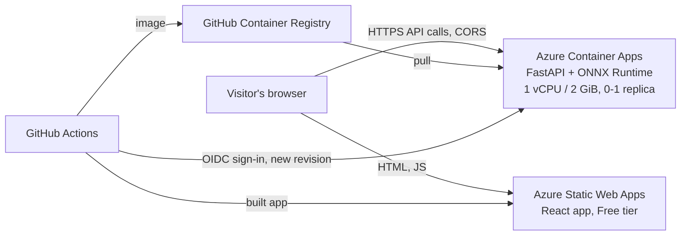

# Deployment

RideSafe AI runs as two parts: a torch-free API container and a static React app. Locally both run in Docker; the
public demo runs on Azure and is redeployed automatically from GitHub.

**Contents:** [Docker](#docker) · [Azure architecture](#azure-architecture) · [Continuous deployment](#continuous-deployment) ·
[One-time Azure setup](#one-time-azure-setup) · [Cost](#cost) · [The public sample](#the-public-sample) · [Operating it](#operating-it)

---

## Docker

```bash
python -c "import secrets; print(secrets.token_urlsafe(32))"   # once: put it in .env as RIDESAFE_ADMIN_TOKEN=...
docker compose up --build        # web app http://localhost:8080, API http://localhost:8000 (RIDESAFE_PORT / RIDESAFE_WEB_PORT)
docker build -f backend/Dockerfile -t ridesafe-api .   # the API image alone
```

The API image ([`backend/Dockerfile`](../backend/Dockerfile)) is built in two stages: the first installs PyTorch and
Ultralytics only to export `models/best.pt` (and the COCO vehicle model for plate reading) to ONNX; the second holds
only ONNX Runtime, headless OpenCV, RapidOCR and FastAPI, plus the anonymised sample job. It runs as an
unprivileged user, keeps uploads and the violation log in `/data`, has a health check and starts in about 3 s.
**Size: 620 MB (259 MB compressed), against 2.27 GB for the PyTorch stage.**

`docker-compose.yml` binds both ports to `127.0.0.1` (only your computer can open them), mounts a volume for
`/data`, and runs the web app behind nginx, which forwards `/api/*` to the API. Locally, plates are shown in full
and uploads are kept (`RIDESAFE_DEMO=false`, `RIDESAFE_UPLOAD_TTL_S=0`).

## Azure architecture



- **API:** Azure Container Apps, consumption plan, UAE North. Scales to zero when idle (the first request after a
  quiet spell takes about 30 s while a replica starts) and to at most one replica, because video jobs and their state
  live in the API process.
- **Web app:** Azure Static Web Apps, Free tier, served from a global CDN. Client-side routes, long-lived caching
  for hashed assets and security headers come from
  [`staticwebapp.config.json`](../frontend/public/staticwebapp.config.json).
- **Production settings:** `RIDESAFE_DEMO=true`; the author key and the image-link key as Container Apps secrets;
  `RIDESAFE_TRUSTED_PROXY=true`; uploads deleted after an hour; CORS limited to the web app and its PR previews.
  The full list is in [API.md](API.md#settings).

## Continuous deployment

Every push to `main` deploys what changed, and only after every test job has passed
([`.github/workflows/ci.yml`](../.github/workflows/ci.yml)):

```
push to main ── lint, unit, smoke, Docker and web tests must all pass, otherwise nothing deploys
  ├─ backend/, models/, configs/ or samples/demo_job/ changed
  │     → image pushed to ghcr.io → new Container Apps revision → live health check
  └─ frontend/ changed
        → React app built with the API address → Static Web Apps
pull request touching frontend/ → a preview copy of the web app, linked on the PR, removed when it closes
manual run (Actions → CI → Run workflow) → deploys both
```

- **No stored passwords:** GitHub Actions signs in to Azure with OIDC federated credentials. That identity may
  change only the RideSafe resource group. The Static Web Apps deployment key is read during the run and never
  saved in GitHub.
- A docs-only commit deploys nothing.

## One-time Azure setup

Done once by the project owner; everything goes in one resource group (`ridesafe-rg`), so deleting the group
removes it all.

1. Push to `main` once, so CI publishes the API image. On GitHub open **Packages → ridesafe-api → Package
   settings → Change visibility → Public** (Azure pulls it without credentials).
2. In **Azure Cloud Shell** (Bash):
   ```bash
   git clone https://github.com/Md-Faiz-Alam/helmet-violation-detection.git
   LOCATION=uaenorth bash helmet-violation-detection/deploy/azure_setup.sh
   ```
   [`deploy/azure_setup.sh`](../deploy/azure_setup.sh) checks which regions the subscription allows, then creates
   the Container Apps environment and app, the Static Web App, the OIDC identity (trusting both of GitHub's subject
   formats), and optionally a budget alert (`BUDGET_USD=0` skips it). It prints the author key once (save it in a
   password manager) and four `gh variable set` commands.
3. Run those four commands on your computer, then deploy everything once:
   `gh workflow run ci.yml --ref main`.

Safe to run again: existing resources are kept. `ROTATE_KEYS=1` makes a new author key.

## Cost

Designed to cost close to nothing on a student subscription:
- nothing runs while idle (scale to zero), and at most one replica runs when busy;
- the monthly Container Apps free grant (180,000 vCPU-seconds) covers about 50 hours of active use;
- no container registry fee (GHCR is free for public images), no Log Analytics workspace, Static Web Apps Free tier;
- a monthly budget alert.

## The public sample

Every visitor first sees a finished analysis of the highway test clip (video: Aamir Somewhere,
[Pexels](https://www.pexels.com/video/34395449/)). The analysis runs on the original video; what is published has
faces and number plates blurred and plate text masked ([`privacy.py`](../backend/ridesafe/privacy.py)), using only
the project's own models:

- **Faces:** the helmet model's head boxes; the lower part of each (the face) is blurred and the top stays visible,
  so you can still see whether there is a helmet. People without a detected head (pedestrians, drivers behind a
  windscreen) get the head end of their COCO person box blurred; a head cut off by the frame edge is blurred whole.
- **Plates:** inside each COCO vehicle box, the OCR text detector plus a plate-shape check (a white or yellow
  rectangle of plate proportions with dense character edges, which catches dirty two-line plates the text detector
  misses).
- **No flicker:** regions found in neighbouring frames are reused, so a plate never flashes readable when a detector
  misses it for a frame.
- The sample's plate crops are removed and plate text is stored masked, because the sample is part of the public
  Docker image. How to rebuild it: [DEVELOPMENT.md](DEVELOPMENT.md#rebuild-the-public-sample).

## Operating it

```bash
az containerapp logs show -n ridesafe-api -g ridesafe-rg --follow          # live API logs
az containerapp revision list -n ridesafe-api -g ridesafe-rg -o table      # deployed revisions
az containerapp replica list -n ridesafe-api -g ridesafe-rg -o table       # running replicas (0 when idle)
```
Uploads and the visitors' violation log live in the replica and are lost when it scales to zero; with the one-hour
upload lifetime that is intended. The sample is part of the image, so it is always there.
